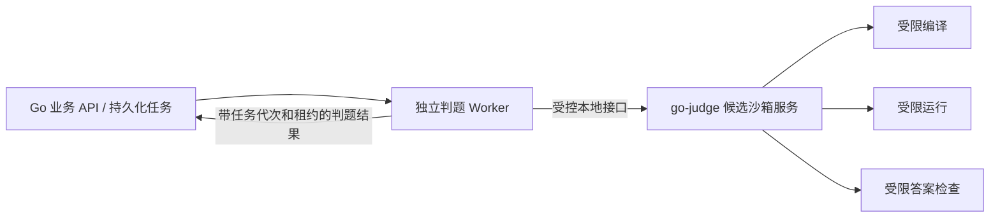

# 前端与判题沙箱选型比较

日期：2026-10-25。版本：0.17。状态：前端、路由/请求/缓存/包管理器、IndexedDB＋idb 本地草稿规则与首批工具链方向已确认，源码文件集/反馈/自测及 API 契约已补充，具体组件准入和预算待验证；已引入 React/Vite 工程骨架，本文业务组件仍待实现。用户已确认模块化单体＋独立判题 Worker、React＋TypeScript＋Vite＋Tailwind CSS＋shadcn/ui 与 CodeMirror 6，并选择优先验证 go-judge。硬件信息后续补充。总体约束见 [总体架构](system-design.md) 与 [需求](../requirements.md)。

用户本轮明确回复：“那就采用 React＋TypeScript＋Vite，更新架构文档，我们继续讨论下一步选型。”这替代此前“继续比较后决定”的状态；下文保留比较依据，不将确认选型等同于依赖安装、功能或性能验证。

## 1. 协会仓库的实际选型

用户指定参考 [协会组织仓库](https://github.com/orgs/DL-Association-for-Computing-Machinery/repositories)。本轮通过 GitHub 只读接口查询，返回 association-website、blog 和当前 OnlineJudge；以下核对前两个仓库的默认分支。没有运行它们的构建、浏览器测试或压测，也不把 README 的历史测试声明当成本轮结果。

| 仓库与快照 | 已核对的前端技术 | 部署证据与边界 |
| --- | --- | --- |
| association-website，`e6f8be13c6f76593ef852381df7935acf9606d28` | React 19、Next.js 16、TypeScript、Tailwind CSS 4；pnpm | package.json 含 next build/start；Next 配置未启用静态导出；README 标注部署尚未配置 |
| blog，`fd181804b14ab6f5cab869cde986aa3ccabd6b51` | React 19、Vite 7、TypeScript、React Router；React Markdown/GFM、Lucide；npm workspaces | 前端 build 为 tsc＋Vite；README 描述静态产物与 /api 反代，Vite 配置中的代理仅为开发配置 |

直接证据：官网 [依赖声明](https://github.com/DL-Association-for-Computing-Machinery/association-website/blob/e6f8be13c6f76593ef852381df7935acf9606d28/package.json)、[Next 配置](https://github.com/DL-Association-for-Computing-Machinery/association-website/blob/e6f8be13c6f76593ef852381df7935acf9606d28/next.config.ts)、[样式入口](https://github.com/DL-Association-for-Computing-Machinery/association-website/blob/e6f8be13c6f76593ef852381df7935acf9606d28/src/app/globals.css)、[README](https://github.com/DL-Association-for-Computing-Machinery/association-website/blob/e6f8be13c6f76593ef852381df7935acf9606d28/README.md)；博客 [前端依赖声明](https://github.com/DL-Association-for-Computing-Machinery/blog/blob/fd181804b14ab6f5cab869cde986aa3ccabd6b51/fd/package.json)、[Vite 配置](https://github.com/DL-Association-for-Computing-Machinery/blog/blob/fd181804b14ab6f5cab869cde986aa3ccabd6b51/fd/vite.config.ts)、[README](https://github.com/DL-Association-for-Computing-Machinery/blog/blob/fd181804b14ab6f5cab869cde986aa3ccabd6b51/README.md)。所列版本为已有仓库声明，不是 OJ 版本锁定；未审计全部依赖或重现部署。

两者共同采用 React＋TypeScript，为 OJ 沿用这一技术家族提供维护一致性的依据。用户现已选择 React＋TypeScript＋Vite。Vue 仍可完成相关业务，但目前核对的两个协会项目没有提供沿用 Vue 的依据；这不是 React 性能优于 Vue 的结论。

官网样式入口同时使用 Tailwind 与自有 CSS；博客前端依赖没有声明 Tailwind、shadcn/ui 或 Ant Design。不能把后续推荐的组件库说成协会现有统一规范，也不直接复制其他仓库的业务实现、权限默认值或公开文件策略。

## 2. React＋Vite 与 React＋Next.js

共同前提：使用 TypeScript；登录、题目权限、提交、计分等业务仍归 Go；正式校赛所需页面与资源全部校内可用。React 是 UI 库，Vite 是构建工具，Next.js 是 React 应用框架；本次比较的是应用组织与运行方式。

| 维度 | React＋Vite 单页应用 | Next.js 静态导出 | Next.js 服务端渲染/混合模式 |
| --- | --- | --- | --- |
| 生产运行单元 | 静态文件入口＋Go API；Node 用于开发/构建 | 同样可只部署静态文件＋Go API | 增加 Next.js/Node 运行服务，Go 继续负责领域业务 |
| 动态题目/提交路由 | 浏览器路由，根据 ID 请求 Go；入口须正确处理深链接 | 需遵守导出时的路由限制；未知动态路径不能直接当作任意服务端路由使用 | 可处理动态路由；要明确服务端取数与浏览器取数的分工 |
| 公开内容首屏与检索 | 默认依赖浏览器 JS；若公开题库需要预渲染，须额外设计 | 可构建时生成 HTML，适合可提前确定的公开页面 | 可动态生成 HTML；公开内容与私有内容须分别设计缓存 |
| 高并发部署 | 静态文件可缓存/多节点分发；Go API 单独分流 | 同左；同时管理构建产物和更新频率 | 静态资源、Node 渲染、Go API 各有容量和故障边界 |
| 运维与资源 | 少一个常驻渲染进程；仍要优化前端包大小与 API 请求量 | 无常驻渲染进程，但需管理路由生成与功能限制 | 增加 Node 内存/CPU、连接、超时、缓存一致性和版本发布管理 |
| 开发代价 | 需组合路由、数据请求、缓存和错误处理约定 | 需持续避免误用需要服务器的特性 | 渲染与路由能力集成更多，但须理解服务端/客户端边界 |
| 与协会现状的联系 | 贴近博客现有路线 | 官网可评估改为此模式，但当前未这样配置 | 贴近官网当前 build/start 路线；不代表官网已生产部署 |

Vite 官方说明其构建产物可静态部署，`vite preview` 不是生产服务器，见 [静态部署文档](https://vite.dev/guide/static-deploy.html)。React 官方通常建议从框架起步，也允许针对项目约束使用 Vite 等工具自行组合；自行组合须承担路由与数据层选择，见 [创建 React 应用](https://react.dev/learn/creating-a-react-app)。

Next.js 官方支持静态导出，不必一律常驻 Node；但未提供 `generateStaticParams` 的动态路由、依赖请求的服务端逻辑等不属于该模式支持范围，见 [静态导出与限制](https://nextjs.org/docs/app/guides/static-exports)。不能既按纯静态部署预算，又默认使用所有动态服务器功能。

### 本项目决定、理由与代价

**用户已确认采用 React＋TypeScript＋Vite。** 选型依据是已有 Go 后端、协会博客技术积累、校内离线与节约服务器资源；核心操作是题目浏览、编辑、提交、训练、榜单和赛务。由 Go 提供动态数据，前端构建为静态资源，无需常驻前端渲染服务。这是架构适配判断，没有框架性能对比实测。

代价是需要明确路由、请求缓存、错误处理等配套约定；默认单页应用也不能自动满足公开题库的搜索收录或分享预览。选择 Vite 不表示用户已放弃这些需求，相关范围仍需产品确认。包管理器已选 pnpm；具体版本及依赖许可证/兼容性/安全检查在首次实现前完成，不直接照搬参考仓库版本。

Next.js 作为已比较的备选保留，不引入当前首期技术栈。若公开题库搜索收录、分享预览、服务器生成首屏成为核心目标，可评估为公开内容补充预渲染；若确需改变框架，则另行记录决策，并核验静态导出的动态路由限制或 Node 服务预算。

不能用“React/Next 能承受多少人”作为单独承诺。负载验证应包含真实路由、题面大小、编辑器、300 人的访问/刷新模式、Go API 与数据库；静态文件吞吐不等于判题吞吐。框架选择也不自动授权复用协会账号、数据库或跨站 Cookie。

## 3. 前端配套与资源控制

用户已确认 Tailwind CSS＋shadcn/ui；2026-10-25 进一步确认 React Router＋TanStack Query＋原生 fetch＋pnpm，并接受第 3.1 节请求、缓存与刷新约定。具体版本、兼容性和运行效果尚未验证；题面已确认 react-markdown＋remark-gfm＋remark-math＋rehype-katex／KaTeX 及第 3.3 节约定；表单等其他配套仍待选。

| 能力 | 已确认或候选 | 对资源与维护的影响 |
| --- | --- | --- |
| 样式与组件 | 已确认 Tailwind CSS＋shadcn/ui | 提供可修改组件源码，需承担复杂表单/表格组合和后续维护；实际引入量、样式一致性及可访问性须验证 |
| 代码编辑器 | 已确认 CodeMirror 6；首版基础在线编辑＋文件上传 | 配置高亮、缩进和快捷键；校验中文输入、键盘操作和实测加载量；文件导入与草稿保存由应用集成，不由编辑器选型自动完成 |
| 代码草稿 | 已确认 IndexedDB＋idb，仅浏览器本地保存 | 保存/恢复/冲突/清理规则见第 3.2 节；本地恢复与正式提交分开，不提供跨设备草稿恢复 |
| 路由 | 已确认 React Router，声明式模式 | 管理题库、题目、提交、比赛和后台导航；验证刷新深链接与权限错误页面，不增加常驻前端渲染服务 |
| 服务端数据 | 已确认 TanStack Query | 管理题目、提交和榜单的加载、内存缓存、刷新与错误状态；与编辑器输入及本地草稿分开 |
| HTTP 请求 | 已确认原生 fetch＋统一封装 | 在 services 层统一状态码、错误、取消/超时和 CSRF；写操作不自动重试，提交超时核验幂等接收状态 |
| 包管理器 | 已确认 pnpm | 单一包管理器与锁文件；已有 `web/package.json` 与 `web/pnpm-lock.yaml`，现行命令见 [README](../../README.md) |
| Markdown 与 GFM | 已确认 react-markdown＋remark-gfm | 题面与出题预览共用渲染组件/配置；支持表格等常用扩展，禁用原始 HTML，限制链接与图片地址 |
| 数学公式 | 已确认 remark-math＋rehype-katex／KaTeX | 行内及独立公式；trust 为 false、展开/尺寸受限，字体/样式本地提供，错误局部提示 |

参考：[shadcn/ui 的源码分发方式](https://ui.shadcn.com/docs)、[Ant Design React 组件](https://ant.design/docs/react/introduce/)、[CodeMirror 项目入口](https://github.com/codemirror/dev)、[CodeMirror 核心扩展说明](https://codemirror.net/docs/extensions/)、[Monaco 项目说明](https://github.com/microsoft/monaco-editor)。此前直接读取 CodeMirror 官网返回 403，随后通过官方站点搜索摘要核对扩展配置说明，并读取项目 README；没有完整版本审计。编辑器的语言配置、中文输入、移动端体验及性能仍需原型验证。

选型取舍：Tailwind CSS＋shadcn/ui 提供样式调整与组件源码修改空间，可沿用协会官网的 Tailwind 方向；这些是方案的适配理由，不推断用户选择背后的额外动机。代价是本项目要维护引入后的组件源码，组合复杂管理功能，并检查上游修复和兼容性。Ant Design 保留为已比较的备选，之前优先建议它的方案由用户此次选择替代，不作为首期主组件体系引入。

实施时先统一颜色、间距、字体、深浅主题等设计变量，再按功能引入组件，避免散落硬编码样式。shadcn/ui 基础组件实现、版本、表单与表格依赖仍须分别核验；本次确认不自动批准所有示例依赖。暂无浏览器原型或性能实测，不由组件名推导包体积、维护成本或并发容量已达标。

用户在 CodeMirror 6 与 Monaco 比较后明确回复“那就codemirror吧”，据此确认使用 CodeMirror 6；Monaco 保留为已比较的备选，不进入首期主编辑器方案。选择理由是可按扩展组合首版需要的基础编辑功能，代价是项目负责语言扩展、快捷键、React 生命周期及文件/草稿流程集成；未通过相同配置实测，不声称必然比 Monaco 更小或更省内存。

首版编辑器范围见需求 AC21；用户明确回复“暂时先支持浏览器本地保存”。首期仅在当前浏览器保存代码草稿，不增加服务器草稿同步及跨设备恢复；后续可按需求另行设计同步。该边界不影响正式提交的服务端持久化，也不适用于出题人的题目草稿。CodeMirror 6 表示所选代际，不等于锁定全部包版本；React 封装、语言包与主题分别核验兼容性、许可证和维护状态。

本地草稿按当前账号、题目、适用比赛与语言组织，切换上下文不能自动带入其他账号或题目的代码；共用浏览器的账号键只是应用隔离规则，不能当作对本机其他使用者的加密保护。用户已确认 IndexedDB＋idb 及第 3.2 节规则；大小上限、总容量和精确依赖版本仍待定。首期无常驻草稿同步服务，本地刷新恢复、失败路径与机房换账号场景仍待验证，不宣称性能或恢复已经达标。

### 3.1 已确认的路由、请求、缓存与刷新约定

选择理由：React Router 的声明式模式负责页面与 URL，TanStack Query 负责服务端数据生命周期，原生 fetch 负责实际 HTTP 传输；pnpm 统一依赖管理。代价是应用需要显式管理查询键、缓存失效、错误映射和请求策略，不能依赖库默认行为自动满足比赛保密及提交幂等。pnpm 的依赖复用作用于开发/构建磁盘，不作为 API 或判题运行容量的证据；生产仍部署版本化静态产物＋Go API。

- **职责边界**：页面/查询 hooks 调用所属模块的 services；公共 HTTP 封装处理传输，业务 services 解释 API 契约。TanStack Query 管理服务端查询数据，编辑器输入和未提交草稿不进入通用查询缓存。React Router 导航和前端权限提示不能替代服务端鉴权；首期不叠加另一套路由加载缓存作为同一数据的权威来源。
- **请求与重试**：提交代码、改密、报名等写操作不自动重试；显式配置 mutation/HTTP 层，不能因库默认值或代理重放改变该约定。提交超时属于接收状态未知，先按原身份/上下文和原幂等键核验接收状态；确需再次发送仍沿用原幂等键，不能自动创建新提交。查询按错误类型执行有界重试与退避，认证/权限错误不无限重试，额外次数和超时预算待接口与实测确定。
- **会话与 HTTP**：沿用同源优先、HttpOnly Cookie、CSRF 与来源校验；fetch 封装明确检查非成功 HTTP 状态、支持取消和超时，取消客户端等待不代表服务端写操作已回滚。会话失效提示重新登录并保留同账号草稿，恢复后由用户确认提交，不自动重放写操作。
- **账号与缓存隔离**：退出或切换账号时清理私有查询缓存，取消旧查询并隔离迟到响应；查询键包含必要的主体/比赛/授权视图及相关版本，防止新账号复用旧账号结果。首期不把敏感查询缓存持久化到浏览器磁盘；本地代码草稿按已有独立规则处理，清理查询缓存不等同删除草稿。客户端缓存不承担权威权限判断，封榜/撤权后的可见性仍由服务端控制。
- **受控刷新**：榜单与判题状态按页面可见性和数据阶段刷新，配置频率、随机抖动、退避及隐藏页面行为；任务终态停止对应状态轮询，避免每条提交建立无界计时器。明确配置窗口聚焦/重连刷新，不能照搬默认策略产生集中请求。断线恢复通过授权 API 读取当前事实，轮询不作为无限延长登录的有效活动。具体间隔与轮询/SSE 最终路线待负载验证。
- **包管理与准入**：首次实现固定兼容的 Node、pnpm 和依赖版本，维护 `packageManager` 声明及 `pnpm-lock.yaml`，CI 使用冻结锁文件方式安装并验证构建，不混用其他锁文件。核对所选版本/传递依赖的许可证、安全与兼容性；pnpm、锁文件与应用 CI 已建立，具体检查归 [CI/CD](../ci-cd.md)，其余业务组件按功能引入。校赛可用性依靠预先构建的本地静态资源，不要求赛时联网安装依赖。

验收关联 AC18/19/20/21/23：深链接直达与刷新、权限失败、写操作超时但服务端已提交、原幂等键核验、查询错误与取消；切换账号后旧缓存/迟到响应不可见、敏感查询无磁盘持久化；聚焦/重连/隐藏页面/多提交下刷新数量有界，终态停轮询、封榜信息不泄漏；冻结锁文件可复现构建、空浏览器缓存下断外网访问。以上尚未执行，不以文档或依赖选型证明通过。

依据（2026-10-25 只读核对）：[React Router 模式](https://reactrouter.com/start/modes)、[TanStack Query 服务端数据](https://tanstack.com/query/latest/docs/framework/react/overview)、[Query 默认行为](https://tanstack.com/query/latest/docs/framework/react/guides/important-defaults)、[Fetch 请求处理](https://developer.mozilla.org/en-US/docs/Web/API/Fetch_API/Using_Fetch)、[pnpm 依赖存储](https://pnpm.io/motivation)。文档入口随上游更新，不代表本项目已锁定对应版本；精确版本及依赖准入仍待实施前核验。

### 3.2 已确认的 IndexedDB 本地草稿规则

2026-10-25 用户确认采用 IndexedDB＋idb，并接受保存、恢复与清理建议。IndexedDB 负责浏览器本地记录及事务，idb 提供 Promise 封装；选择理由是以异步存储和事务承载分上下文草稿及冲突检查。代价是维护浏览器数据库升级、失败处理、多标签协调及清理协议；localStorage 保留为比较背景，不作未经验证的自动回退。具体 idb 版本、许可证/兼容性与包大小仍待引入前核验，本轮未安装或运行。

| 项目 | 已确认的首期规则 |
| --- | --- |
| 自动保存 | 停止输入 1 秒后保存；持续输入时目标每 5 秒保存一次 |
| 草稿归属 | 按账号、题目、适用比赛与语言分别保存，包含必要的内容版本与保存状态 |
| 保存反馈 | 事务成功且匹配当前编辑版本后显示“已保存”；失败明确提示，并允许下载代码 |
| 多标签冲突 | 检测版本冲突，保留双方内容供用户选择，不静默覆盖 |
| 保留期限 | 首期不按时间自动删除，提供导出与手动清理入口 |
| 主动退出 | 提供“清除此账号本地草稿”选项，默认勾选、允许取消；仅清理当前账号在当前站点/浏览器内的草稿 |
| 会话自然过期 | 保留草稿，同账号重新登录后恢复；恢复后由用户确认提交，不自动提交代码 |

保存调度应避免一直输入导致永不保存；1 秒/5 秒为调度初值与目标，不是崩溃或后台挂起时的数据丢失上界。写入按内容版本协调，迟到的旧写入不能覆盖新版本或把更新中的代码标成已保存；以事务完成确认该版本保存成功，而不是仅凭某个写请求成功。刷新仅恢复已成功保存的版本；页面关闭和崩溃前的最后保存不能保证完成，正常导航/切换上下文尽力保存并提示未保存状态，不用关闭页面时的一次异步请求承担全部持久化。

多标签版本检查与写入须在同一浏览器数据库事务内协调；发生冲突时保留当前编辑内容和已存版本，提供选择/导出入口。不能只依据本地时钟做无条件最后写入覆盖。容量不足、数据库不可用或冲突副本无法写入时如实提示当前内容尚未保存，保留仍可用的内存内容及下载入口，不为释放空间静默删除其他草稿。草稿大小、总量、冲突副本上限及失败后的有界重试预算仍待实现设计，不将“不按时间自动删除”解释为无限容量。

主动退出的草稿清理与服务端会话撤销分别报告成功/失败。清理前处理尚未保存内容的导出提示，跨标签通知并使该账号的旧保存任务失效；清理操作和后续写入按本地代次/版本协调，避免另一个标签或迟到任务复活已清理代码。取消清理则保留草稿；退出或切换账号后不展示旧账号内容，只有重新核验同账号身份后才恢复对应草稿。会话过期不触发自动删除，也不允许切换账号恢复别人的代码。

草稿服务与 TanStack Query 私有查询缓存分开；清理查询缓存不等于清理草稿，主动退出选项也不清理其他账号、其他站点数据或服务端提交。浏览器同源存储不是对本机其他使用者的加密保护；清除浏览器数据、浏览器回收或更换设备可能使草稿不可恢复，提供下载备份，不承诺跨设备或永久保存。数据库模式升级须兼容已有草稿并处理旧标签阻塞；不可通过删库重建静默丢弃内容。

AC21/23 增补：用可控计时验证停输保存与持续输入调度、仅提交事务对应版本显示已保存、乱序写入及刷新恢复；覆盖多标签同时编辑/冲突副本、容量不足/存储禁用/数据库升级受阻、账号与比赛/语言隔离、退出清理默认勾选/取消、清理与迟到保存竞态、会话过期后同账号恢复、手动导出与清理。真正断外网验证本地保存，无法从被清除的数据或另一设备恢复时提示准确；目前均未执行。

依据（2026-10-25 只读核对）：[IndexedDB API](https://www.w3.org/TR/IndexedDB/)、[idb 事务与升级说明](https://github.com/jakearchibald/idb)。1 秒/5 秒及清理规则为用户确认的项目默认，不是浏览器持久性保证。后续已确认第 3.3 节 Markdown 与公式渲染组件/约定；首期题型与判定原则后续已确认，见 [判题设计](judging-design.md)；题包模型与子集导入验证路线后续已确认，见 [题包设计](problem-package-design.md)；SPJ 协议、testlib 优先验证及首批 GNU++17 后续已确认，见 [判题设计第 4.1 节](judging-design.md#41-已确认的-spj-协议与-testlib-验证路线)；浮点比较规则已确认，见判题设计第 3 节，数值实现待验证；测试顺序/提交内串行/首次失败停止已确认，见判题设计第 5.1 节，编排实现待验证；分类、资源、反馈及自测已确认，实施按总体架构和专题文档验证。

### 3.3 已确认的题面 Markdown 与公式渲染

2026-10-25 用户确认 react-markdown＋remark-gfm＋remark-math＋rehype-katex／KaTeX，并接受渲染约定。react-markdown 将 Markdown 转为 React 元素，remark-gfm 提供表格等 GFM 扩展，remark-math 解析公式，rehype-katex 调用 KaTeX 渲染；应用负责资源、样式、输入约束和错误反馈。具体版本、传递依赖、许可证及兼容性须在引入前核验，尚未安装或运行。

选择理由：在 React 页面内组合 Markdown、常用扩展和数学公式，按现有静态资源＋Go API 路线部署；出题预览与选手页面可复用同一条渲染流程。代价是维护插件组合、配置/样式、地址限制和公式兼容；KaTeX 仅支持其规定的 TeX 功能，不宣称完整 LaTeX 文档或所有宏都可用。方案不自动选定富文本编辑器、代码块高亮库、HTML 导入或任意插件。

- **预览一致性**：出题预览与选手题面使用同一组件、插件集合和配置，按题目版本读取经授权的 Markdown 原文与资源。保留原文，配置变化须记录兼容性及回归结果；前端复用不替代题目版本、发布审核或私有材料权限。公式语法与转义规则以锁定版本的解析器为准，不能用正则自行替换公式。
- **HTML 与地址边界**：首期禁用 Markdown 中的原始 HTML，不启用任意 HTML 解析或执行；链接/图片采用受控协议和地址规则，不允许危险脚本协议或任意嵌入页面。自定义 React 组件及插件仍须核验输入和输出，不能因为主库默认行为而假定所有扩展安全；预览和正式页面执行同样限制。题面图片经校内资源与授权接口提供，逻辑资源标识与物理路径分开，图片地址不授予其他私有材料访问权。
- **公式与错误处理**：KaTeX 保持 `trust: false`，对公式长度、宏展开及渲染尺寸设置有限预算；具体数值在实际题目与浏览器验证后定版，不将默认值当作容量保证。公式失败局部提示，出题预览明确标出位置；选手页面保留可读的公式源码/替代提示，不能因单条公式导致整页失败。错误信息按文本呈现，不把未转义公式源码或错误内容当 HTML 注入。
- **校内资源**：题面图片、KaTeX CSS 与字体随受控版本资源在校内提供，真正断外网且新浏览器无缓存时也应可读；不依赖赛时 CDN。字体/图片加载失败须有可见反馈，校验生产打包后的相对地址、字体路径、访问权限和资源版本切换。
- **样例文本**：样例输入和输出作为独立原始文本展示并提供复制，保留空格、换行及空样例的语义，不经 Markdown/公式解析或自动格式化。展示容器可滚动以适配长行，复制不附加提示符、行号或其他装饰内容；具体字段/导入编码与题目包契约后续定义，不能由渲染器修改判题数据。

验收关联 AC06/17/18/20：同一题目版本的预览/选手视图在标题、列表、表格、代码块、行内/独立公式与图片上符合统一规则；检查样例空格/空行/尾部换行及复制文本一致。覆盖原始 HTML、危险 URL、插件/自定义组件输出、私有图片越权、错误/超长/高展开公式、错误文本转义、窄屏横向溢出、字体缺失和断外网冷缓存访问；测量渲染开销并确认有限预算。上述均未运行，不将库声明替代应用验证。

依据（2026-10-25 只读核对）：[react-markdown 公式组合与边界](https://github.com/remarkjs/react-markdown)、[remark-gfm](https://github.com/remarkjs/remark-gfm)、[remark-math 与 rehype-katex](https://github.com/remarkjs/remark-math)、[KaTeX 安全配置](https://katex.org/docs/security.html)、[KaTeX 支持范围](https://katex.org/docs/supported.html)。保留具体版本准入、浏览器效果及资源预算验证；首期题型与判定原则后续已确认，见 [判题设计](judging-design.md)；题包模型与子集导入验证路线后续已确认，见 [题包设计](problem-package-design.md)；SPJ 协议、testlib 优先验证及首批 GNU++17 后续已确认，见 [判题设计第 4.1 节](judging-design.md#41-已确认的-spj-协议与-testlib-验证路线)；浮点比较规则已确认，见判题设计第 3 节，数值实现待验证；测试顺序/提交内串行/首次失败停止已确认，见判题设计第 5.1 节，编排实现待验证；分类、资源、反馈及自测已确认，实施按总体架构和专题文档验证。

节约资源还应落实到：

- 生产部署版本化静态产物，资源文件名带内容哈希；HTML 使用适合更新的缓存策略，滚动发布保留旧资源以免旧页面动态加载失败。API 路由不能被 SPA 的 HTML 回退吞掉。
- 编辑器、图表、管理页面、滚榜演示按路由或功能加载；字体、图片、公式资源、编辑器 Web Worker 与语言资源本地打包，不依赖赛时 CDN。
- 排名表按需要分页/虚拟化；刷新带随机抖动与退避，限制在途请求。推送断线后可从授权 API 恢复，不每次轮询重算全场成绩。
- 前端不包含未公开题目数据、标程、隐藏榜单或秘密；代码拆包不等于服务端授权。客户端按钮限制不能替代后端鉴权。
- 真正断外网、空浏览器缓存、桌面与手机、新登录、题目深链接、输入法、键盘导航与版本切换都列入原型验收；按实测制定首屏传输量和浏览器内存预算，不在无原型时虚构体积数字。

## 4. 判题 Worker 与沙箱的职责

图中 API 到 Worker 表示任务流向，网络上仍由 Worker 主动领取。Worker 负责材料准备、语言命令模板、租约、执行编排、答案比较、错误分类和结果回报；沙箱负责受限执行与资源观测。测试编排按 [判题第 5.1 节](judging-design.md#51-已确认的测试顺序与提前停止)：需编译语言每尝试编译一次、逐点使用新隔离环境并串行检查、首次选手失败停止；不同提交仍按容量并行，系统故障中止并有限恢复，不混算未执行测试的统计。具体编排、隔离与恢复尚未实现。不能把沙箱报告的“进程正常结束”直接等同 OJ 的 AC，仍须答案检查与题目规则判定。

编译器、用户程序、生成器、候选标程和检查器都需要受限执行，但权限和输入应按阶段最小化。选手运行阶段只获得本次必要输入，不能同时挂载标准答案、标程、其他提交或整个私有题库；检查阶段才受控提供答案和输出。

## 5. go-judge 与 isolate 比较

| 维度 | go-judge | isolate |
| --- | --- | --- |
| 组件定位 | 提供受限执行的服务接口，含 REST，gRPC 可配置 | Linux 受限进程执行工具，典型流程为 init/run/cleanup |
| Worker 对接 | 调用本机服务并映射结果；须管理请求认证、取消、超时和服务生命周期 | 调用命令行并解析元数据；须管理 box 标识、进程、目录、取消与清理 |
| 运行基础 | Linux、cgroup 等能力；具体部署权限需核验 | Linux namespaces/control groups；具体版本安装与系统配置需核验 |
| 资源成本 | 常驻服务、环境池与文件缓存均须计入预算；不能忽略默认内存缓存 | 进程调用与 box 生命周期有开销；也须管理工具链、缓存和资源限制 |
| 许可证标识 | 上游当前 LICENSE 为 MIT | 上游当前 LICENSE 为 GPL-2.0-or-later |
| 本项目状态 | **用户已选择优先验证**；尚未正式采用 | 备选，若首选无法满足权限、限制、稳定性或预算要求，再做同场景对照 |

组件事实来源：[go-judge README](https://github.com/criyle/go-judge)、[go-judge LICENSE](https://github.com/criyle/go-judge/blob/master/LICENSE)、[isolate README](https://github.com/ioi/isolate)、[isolate 手册](https://github.com/ioi/isolate/blob/master/isolate.1.txt)、[isolate LICENSE](https://github.com/ioi/isolate/blob/master/LICENSE)。许可证名称只是本轮查阅事实；安装、修改或分发前仍需核对选定版本及依赖的准入要求。

优先 go-judge 的理由是接口式对接与独立 Worker 边界匹配，能减少命令行生命周期胶水代码；Go 实现也便于同栈排障。它不是因为名称相同就更安全或更快。未做两者性能、安全审计或运行比较，不能声称 go-judge 一定更省内存、isolate 一定更快，或者任何沙箱不会被突破。

Docker 可以承担组件打包与环境分发，但不能仅凭“放进 Docker”认定判题隔离完成。go-judge 上游快速开始包含特权容器示例；本项目不直接套用到业务主机，也不公开执行服务端口。服务可执行文件部署是可评估路径，但 Linux 权限、cgroup 委派、系统调用与挂载策略仍须核验；“不用 Docker”不等于“不需要权限”。

## 6. go-judge 优先验证计划

在不含生产凭据、用户资料和真实私有题库的隔离 Linux 环境开展。M0 已在本机独立 Colima VM 运行固定摘要的 go-judge 1.13.3＋GCC 15.3.0 合成夹具，真实超限/隔离分项通过，见[M0 记录](../m0-experiment.md)。完整 Worker、所有语言、故障恢复及镜像安全/许可清单仍待验收，不批准进入正式节点或宣称无已知漏洞。

| 验证主题 | 必须观察的行为 |
| --- | --- |
| 环境与权限 | 核对内核、cgroup 版本/控制器、挂载和所需权限；权限不足时失败可见，不能静默无隔离运行 |
| 语言配置 | 用户已确认首批 C／C++、Java、Python 3，PyPy 后续评估；逐种验证并固定编译器/解释器实现、版本和命令。线程、子进程、JIT、启动开销及内存统计各自校准；不凭语言名称套用统一资源参数 |
| 限制与结果映射 | 编译失败、错误答案、运行异常、CPU 时间/墙钟超限、内存超限、输出和临时盘超限；区分选手错误、检查器失败和系统错误 |
| 隔离 | 禁止非授权网络、宿主与其他任务文件访问；验证进程数上限、任务间残留和凭据不可见；不依赖容器名称判定隔离 |
| 生命周期 | 超时、取消、Worker/沙箱重启后无遗留任务或目录污染；旧租约结果不能生效；缓存失效可从持久化材料恢复 |
| 资源与公平性 | 测量空闲开销、冷启动/热运行、编译峰值、混合语言并发；并发与缓存预算由可用资源决定，不照搬默认 CPU 数或默认缓存配置 |
| 数据保密 | 编译日志、错误输出、测评结果按大小截断和授权呈现；选手反馈不泄漏正式数据或内部文件路径 |

先用标准输入输出文本题完成最小端到端实验，再补齐首期已确认的显式浮点容差与受限 SPJ，完整范围见 [判题设计](judging-design.md)。交互题与直接提交答案题已确认后续扩展，首期不提供；不能由沙箱存在流式接口推导已支持。独立执行节点的数量与具体并发等硬件补充后确定；等待硬件期间可完成协议、适配接口和验收设计。

命令与工具链由服务端维护固定配置，记录到提交和判题尝试；选手不能自定义宿主执行命令。语言时间/内存倍率、编译限制、线程与进程上限须用同组节点的真实样例校准，并向选手说明适用规则；首期不开启未经验证的语言配置，全部首批语言通过后才能声明该范围交付完成。

### 6.1 首批工具链与语言标准

用户于 2026-10-25 确认以下方向；M0 已固定实验镜像摘要并测试 GCC 15.3.0 的 GNU++17 子集，其余语言及生产配置尚未验证，详见[M0 实验](../m0-experiment.md)。

| 语言配置 | 已选工具链 | 标准与范围 |
| --- | --- | --- |
| C17 | GCC 15 的 gcc | 显式指定 `-std=c17` |
| GNU++17 | GCC 15 的 g++ | C++ 默认配置，显式指定 `-std=gnu++17` |
| GNU++20 | 同一套 GCC 15 的 g++ | C++ 可选配置，显式指定 `-std=gnu++20` |
| Java 21 | Eclipse Temurin JDK 21 | 编译与运行使用配套 JDK；首期不启用预览特性 |
| Python 3.14 | CPython 3.14 | 首期按常规解释器构建验证；PyPy 后续评估 |

选择理由：C/C++ 共用一套工具链，通过明确的标准参数提供两种 C++ 模式；Java 与 Python 各维护一个主版本，控制环境分发、离线准备和回归矩阵。代价是暂不覆盖其他编译器、Java 主版本及 Python 实现；需要对所选组合承担更新与兼容性验证。GCC 14/16、Clang、Java 17/25 与其他 Python 版本保留为比较背景，不自动成为支持范围。

这不是性能排名：未证明旧版本更快、更省内存或新版本更不稳定。标准选项也不等于完整实现该标准的全部特性；仅对实际编译命令、标准库和测试覆盖作支持声明。参考：[GCC 标准说明](https://gcc.gnu.org/onlinedocs/gcc/Standards.html)、[C++ 支持表](https://gcc.gnu.org/projects/cxx-status.html)、[Temurin 支持政策](https://adoptium.net/support)、[Python 版本状态](https://devguide.python.org/versions/)（2026-10-25 查阅，支持政策随发行方变化）。

实施与验收要求：

- 语言配置绑定精确补丁版本、发行方构建、系统/架构、标准库、编译及运行参数和环境制品哈希；界面、比赛配置、提交与判题尝试均可追溯该配置。重判默认沿用原配置，变更环境须记录新版本及原因。
- 同一语言配置在各 Worker 上保持一致，领取任务时匹配配置与节点能力；正式比赛前完成校准、离线预热和断外网验证，比赛期间冻结常规升级。
- C++ 两种模式分别验证语法、标准库、正确/错误/超限程序及多节点一致性；可用 GCC 15 支持的 C++20 专属语法检查模式是否确实切换。C17、Java 21、Python 3.14 同样覆盖成功、失败、超限与恢复。
- 编译参数、优化等级、链接策略、Java 主类/文件规则、JVM 参数、Python 启动参数和可用库清单尚待实现设计；此表中的 `-std` 仅固定标准，不是可直接部署的完整命令。
- JVM 堆上限不能代替整个进程的内存限制；编译、解释器启动、线程/子进程、CPU/墙钟和输出分别计量。真实资源额度与并发槽位须实测，不能直接给 Java/Python 套固定倍率。
- 更新前检查选定版本的许可证、安全公告及回归结果，再发布新的固定环境；不使用浮动标签在运行期间自动升级。旧环境保留或受控替换策略须兼顾可追溯重判与安全修复。

## 7. 当前结论与下一步

提交协议保留统一源码文件集和语言入口；试用版仅单文件编辑/上传，多文件/ZIP 与相应草稿升级另行排期，启用时须原子保存文件集与入口并兼容旧记录，见 [提交规则](judging-design.md#7-提交文件集反馈与自定义输入)。正式反馈及自测启用、隔离和临时保留规则同节；API 契约、幂等与错误见 [接口设计](api-worker-design.md)。这些业务能力尚无浏览器或真实提交验收；本轮浏览器验证仅覆盖骨架页与 API 连通。

- **已确认**：模块化单体＋独立判题 Worker；React＋TypeScript＋Vite＋Tailwind CSS＋shadcn/ui；CodeMirror 6；首期代码草稿仅浏览器本地保存；硬件后补；优先验证 go-judge。
- **首批工具链**：GCC 15＋C17、GNU++17 默认和 GNU++20 可选；Temurin JDK 21；CPython 3.14。PyPy 后续评估；补丁版本、命令和资源限制待验证。
- **存储**：数据库小数据＋校内本地大文件＋Worker 缓存已确认，见 [存储设计](storage-design.md)。
- **下一步选型**：数据库访问层优先验证 sqlc＋pgx，Goose＋SQL＋独立迁移步骤＋显式锁已确认，见 [总体架构](system-design.md#811-数据库迁移)；登录路线及规则见 [会话设计](session-design.md)，SCS＋go-redis 优先验证、Gin sessions 备选，密码已选 Argon2id＋独立随机盐＋可升级参数记录。日常邮箱验证注册/找回与正式比赛校内发号/人工核验重置已确认；可替换 SMTP 接口已确认、go-mail 优先验证，供应商待条件明确；优先验证 PostgreSQL 持久化发信任务＋独立受限发送执行器；River 开源核心优先验证、专用表备选；短期 AES-GCM 载荷、River 仅存 ID 和独立密钥文件已确认；不考虑付费方案；令牌期限/重发/发信重试已确认，见 [会话设计第 12 节](session-design.md#12-已确认的令牌有效期重发与发信重试)。React Router（声明式）＋TanStack Query＋fetch＋pnpm 及第 3.1 节约定已确认；IndexedDB＋idb 及第 3.2 节草稿规则已确认；渲染组件及第 3.3 节约定已确认；首期题型与判定原则后续已确认，见 [判题设计](judging-design.md)；题包模型与子集导入验证路线后续已确认，见 [题包设计](problem-package-design.md)；SPJ 协议、testlib 优先验证及首批 GNU++17 后续已确认，见 [判题设计第 4.1 节](judging-design.md#41-已确认的-spj-协议与-testlib-验证路线)；浮点比较规则已确认，见判题设计第 3 节，数值实现待验证；测试顺序/提交内串行/首次失败停止已确认，见判题设计第 5.1 节，编排实现待验证；分类、资源、反馈及自测已确认，实施按总体架构和专题文档验证。工具链补丁、密码参数、语言资源策略与草稿容量/升级/运行实现仍待验证和设计，候选清单不等于已批准引入。
- **UI 决策边界**：采用 Tailwind CSS＋shadcn/ui，具体设计风格和基础组件配置尚待原型确定；不额外引入 Ant Design 主组件体系，也不以库名推导包体积或服务器容量。
- **后续验证**：前端在相同页面/数据/硬件条件下测包大小、交互与请求量；沙箱在隔离 Linux 节点测权限、正确性、恢复和资源。不能以协会仓库存在或文档检查通过替代这些验证。
