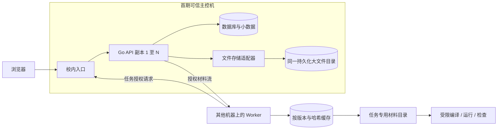

# 服务端存储与 Worker 缓存设计

日期：2026-10-25。版本：0.5。状态：分层路线已由用户确认，接口与一致性细节为设计要求；无实现或运行验证。关联 [总体架构](system-design.md)、[ADR-001](001-go-gin.md) 与 [需求验收](../requirements.md)。

## 1. 决策与取舍

用户明确要求：“先采用数据库保存小数据＋校内本地磁盘保存大文件＋Worker 本地缓存，预留以后迁移到对象存储的接口”。

- 首期减少独立存储服务的部署与维护，核心材料在校内可用；Worker 复用固定版本材料，减少重复下载。这是设计理由，不是容量实测结论。
- 主控磁盘承担大文件的权威存储，存在主机、磁盘与网络故障点；同机 API 多副本及 Worker 缓存不提供主控容灾。备份必须使用独立故障域的存储，并演练恢复。
- NFS/NAS 和校内对象存储作为后续统一存储后端备选，本轮不引入。公有云不能成为断外网校赛的唯一材料来源；不把全部大文件放进业务数据库。
- 数据库仍按已确认的 PostgreSQL＋持久化任务表路线优先验证，尚未完成正式组件准入；本次选择不等于数据库或沙箱已经验证。

## 2. 数据归属

| 数据 | 首期权威位置 | 约束 |
| --- | --- | --- |
| 用户、权限、题目/比赛元信息、提交状态、结果、任务 | 数据库 | 按所属业务模块和事务管理 |
| 活动登录会话 | Redis | 已确认共享 Session；账号状态与权限仍归数据库，会话丢失不丢提交，恢复须防撤销回退，见 [会话设计](session-design.md) |
| 受大小限制的提交源代码 | 数据库，与提交/任务接收事务一起持久化 | 按实际字节及编码规则校验；大于上限明确拒绝，不静默改走临时文件；限制值待定 |
| 题目测试输入、标准答案、图片、附件和原始题目包 | 主控机上的校内持久化目录 | 数据库保存逻辑文件标识、大小、哈希、所属题目版本及权限；不保存用户可控的宿主绝对路径 |
| Worker 下载的固定版本材料 | Worker 本地缓存 | 可删除后重建，不是唯一副本或备份；有容量与下载并发上限 |
| 编译产物、运行输出、临时日志 | 任务临时目录 | 按任务限制大小和生命周期；需留存的诊断材料显式转入受控持久化存储 |
| 选手未提交代码草稿 | 当前浏览器 IndexedDB＋idb | 按账号/题目/比赛/语言隔离，保存/恢复/冲突/清理按 [草稿规则](frontend-sandbox-options.md#32-已确认的-indexeddb-本地草稿规则)；不新增服务器同步或跨设备恢复 |

“小/大”不是由扩展名自动决定：按数据用途、大小限制与保留策略分类。大小上限、缓存额度、日志保留及备份容量在硬件核验后设定。

## 3. 拓扑与授权

- 首期 API 副本在同一主控机共享同一持久化目录；容器部署时也必须映射同一持久化位置，不能各写容器临时层。数据库的具体部署位置仍由硬件预算确定，图示不是已部署拓扑。
- Worker 可分布多机，通过受认证、任务范围内的材料接口下载；不直接挂载整个主控私有题库，不获取业务数据库凭据。下载实现可评估成熟 HTTP 文件传输能力，不自研通用分布式文件系统。
- API **跨主机扩展之前**，必须使所有副本经统一材料服务或共享/对象存储后端访问同一份权威材料；不能依靠负载均衡、粘性会话或人工复制目录掩盖数据缺失。
- 每次读取先校验题目/比赛授权或有效 Worker 任务授权；命中缓存不能绕过授权。猜中逻辑标识或内容哈希不授予访问权。
- 选手进程只能访问当前执行阶段所需材料：运行阶段不暴露标准答案、其他测试数据或整个缓存；检查阶段按需提供答案和输出。缓存根目录及服务凭据不进入选手沙箱。

## 4. 文件发布与一致性

数据库与文件系统不共享一个原子事务，按“先完整保存材料、再发布数据库引用”设计：

1. 校验上传者权限与大小预算，在受控暂存位置流式写入；文件名由服务端生成。解包时限制展开体积、文件数及路径，不接受越界路径或可访问宿主文件的链接。
2. 校验实际长度、内容哈希和材料清单，完成持久化后才转为不可变文件；具体文件系统的崩溃一致性与并发写入语义须验证。并发写同一材料时不可暴露半文件或覆盖已发布内容。
3. 在数据库事务中发布题目版本及其完整材料引用；发布失败时材料可以成为暂存孤儿，不能反过来先发布引用再补写文件。
4. 未发布或未引用材料按保留期回收，回收与正在发布的文件有协调机制；存在有效题目版本、历史提交、备份保留或进行中任务引用时不能删除。引用判定不能仅依赖一次无锁快照。

已确认原始题包只读保留并记录哈希、来源及使用依据，仍为受限材料；内部转换、修正和重新导入不覆盖原包，原包与发布材料按引用/保留策略纳入备份，详见 [题包设计](problem-package-design.md)。已发布题目材料不原地修改，新数据产生新版本。磁盘不足、哈希失败或写入中断时，上传/发布返回明确失败；材料读取失败属于系统错误，不能判成选手答案错误。

## 5. Worker 缓存

- 缓存键关联不可变材料标识与哈希；题目版本或材料变化不复用旧内容。下载到暂存文件，校验完整性后再标记可用，同节点重复下载需合并或协调。
- 正在使用的缓存不得被回收。缓存目录由 Worker 控制，避免选手输出反向污染；每个任务分别准备目录并限制可见文件。
- 缓存有磁盘上限、水位、下载并发及清理策略；缓存清空、损坏、Worker 重启后可以重新下载。赛前可预热正式比赛材料，但预热不代替在线授权和校验。
- 主控存储失效时，已缓存材料可能继续供已授权任务使用，但不能保证整个判题链路可用；任务领取、代码、结果回报与新材料仍有服务依赖。

## 6. 对象存储迁移接口

应用只依赖小型文件存储接口：不可变写入、读取元信息、流式读取；清理由受控保留流程调用。接口返回逻辑标识、大小和内容哈希，明确不存在、无权限、完整性失败与服务不可用等错误。调用需要取消/超时，不能要求一次把大文件读入内存。

首期用本地目录适配器实现；数据库中的物理位置归存储模块管理。业务模块、Worker 协议和题目版本只引用稳定逻辑标识，不依赖磁盘路径、S3 bucket URL 或供应商 SDK。保留对象存储适配位置，不提前实现多套后端，也不假定所有对象存储支持相同的版本控制功能。

未来迁移作为独立运维任务：备份 → 在受控窗口暂停材料变更 → 按清单复制 → 核对数量/大小/哈希 → 更新位置映射 → 验证授权读取和重判 → 保留旧材料一段回退期。切换失败可按记录恢复旧映射；切换后若已接受新写入，回退必须先处理新增材料。是否采用在线迁移届时另行设计，本轮不承诺无停机迁移或自动双写。

## 7. 备份与验收

备份包括数据库快照、对应版本的材料清单及全部被引用文件；恢复时核对引用完整性和内容哈希。相同磁盘的另一个目录、Worker 缓存以及同机副本都不作为独立备份。已确认一致性恢复集合＋独立副本＋定期恢复演练，pgBackRest/restic 分别优先验证数据库和大文件；恢复代次、会话/令牌撤销及分类两阶段回收见 [运维设计](operations-design.md)。频率、保留时间、RPO/RTO 与备用设备等待学校条件和恢复目标确定。

以下均待实现后执行，对应 AC06、AC16—20 及新增 AC22：

- 多个同机 API 副本上传后互相可读；重启或重建后引用及文件仍完整。
- 写入/发布各阶段中断、并发写入、磁盘不足与孤儿回收不产生可见半文件、丢失引用或误删。
- Worker 缓存冷启动/命中/损坏/清空/回收时结果一致；实际选手沙箱不能读取标准答案或整个缓存。
- 未授权用户、过期/无效任务及目录穿越请求不能取得私有材料；缓存命中也不能越权。
- 用独立备份恢复数据库及文件，再运行既有题目版本和重判，确认材料与成绩可追溯。
- 硬件确定后测量冷/热缓存网络流量、磁盘 I/O、下载延迟和空间水位；不以人数或组件存在推导容量达标。

首次实现只验证本地适配器及逻辑接口契约；真正引入对象存储时，必须对该后端另做一致性、迁移、回退与权限验证。
