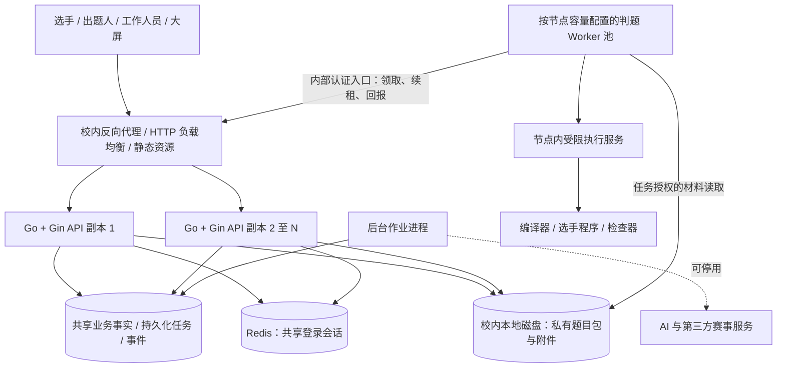
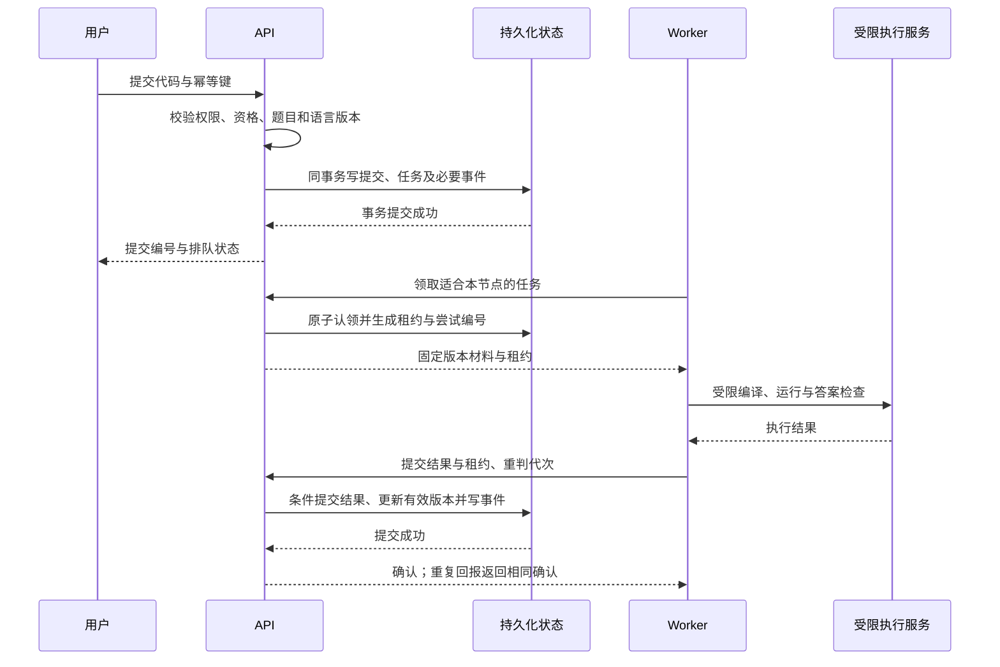

# OnlineJudge 总体架构讨论稿

版本：0.30。日期：2026-10-25。状态：总体结构、前端及路由/请求/缓存/包管理器、存储分层、首批工具链、Goose 迁移、Session＋Redis、会话/比赛账号规则、Argon2id 及邮箱验证注册/找回路线已确认；SCS＋go-redis 为优先验证路线，可替换 SMTP 接口已确认、go-mail 和 PostgreSQL 发信任务＋独立受限执行器优先验证，River 开源核心优先验证、专用表备选，AES-GCM 短期载荷、独立密钥文件、不考虑付费方案及令牌/重发/重试规则已确认，邮件服务待定，后续确认已收敛为架构基线；专题见比赛、接口与任务、运维文档；已建立工程骨架但无训练/比赛业务实现。本文在 [ADR-001](001-go-gin.md) 的设计基线上展开；不把候选组件、容量推算或未来验收写成已确认选型或实测结果。

## 1. 架构目标与决策状态

选型约束：用户明确不考虑付费方案或技术栈，包括商业付费功能、许可证和付费服务；River Pro 排除。优先评估可免费使用、可自托管的开源组件，并核对具体版本及依赖许可证；开源不自动意味着任意用途免费。邮件优先核验学校/协会已有且允许应用使用的 SMTP，不能把限期试用或可能自动扣费的额度当作长期方案。此约束不表示硬件、域名和运维没有成本，也不授权购买；条件不足时保留未解决项。

| 项目 | 状态 | 对架构的影响 |
| --- | --- | --- |
| Go + Gin 自研，参考成熟 OJ | 已确认 | 自有业务模型，复杂基础能力优先复用 |
| 先打通训练判题，再完成校赛 | 2026-10-25 用户确认 | 先验证提交到结果的完整路径；不取消校赛原有需求 |
| 正式校赛支持校内断外网运行 | 2026-10-25 用户确认 | 核心链路及页面资源在校内闭环，外部集成可停用 |
| 约 300 人、分布式判题 | 已确认需求，未压测 | 判题节点可独立扩容，容量指标在硬件盘点后定版 |
| 负载均衡、高并发、资源节约 | 用户明确要求；资源有限是规划前提，实际规格未知 | 分别设计 API 请求分流、判题任务分配和全局资源预算，避免过度部署 |
| 模块化单体＋独立判题 Worker | 用户已确认先采用，尚未实现 | 业务模块保留清晰边界；执行选手代码与业务服务分离 |
| 机器数量、CPU、内存、网络、权限 | 用户答复“有待询问” | 不确定节点数、并发数、部署规格与恢复时限 |
| PostgreSQL＋持久化任务表 | 用户选择优先验证路线；正式采用待验证 | 先验证事务、租约、故障恢复与数据库负载 |
| sqlc＋pgx | M0 已引入，真实数据库提交/租约核心测试通过 | 显式 SQL、生成调用与有界连接池；生产负载与完整系统验收仍待完成 |
| Goose＋SQL 迁移文件 | M0 已实现独立迁移步骤与 advisory lock | 空库/并发/锁超时/回退约束已验证；完整迁移故障恢复与生产升级待验收 |
| 服务端 Session＋Redis＋HttpOnly Cookie | 用户已确认，尚未实现 | 共享活动会话；账号及权限归数据库，详见 [会话设计](session-design.md) |
| SCS＋go-redis | 用户选择优先验证；正式采用待验证 | Gin sessions 保留备选；核验 Gin 适配、凭证摘要、期限及并发撤销协议 |
| Argon2id 密码哈希 | 用户已确认，尚未实现 | 每个密码独立随机盐、可升级参数记录；具体参数待硬件确定后验证，见 [密码设计](session-design.md#7-密码保存与校验) |
| 注册、找回与发号 | 用户已确认，尚未实现 | 日常邮箱验证注册＋密码登录＋邮箱自助找回；正式比赛校内发号＋人工核验重置，见 [账号流程](session-design.md#8-注册找回与账号发放)；域名/现有 SMTP 未知，可替换 SMTP 接口已确认，go-mail 优先验证、供应商待定 |
| PostgreSQL 持久化发信任务＋独立受限发送执行器 | 用户选择优先验证，尚未实现 | 与判题任务分表、分配额，不需独占服务器；River 开源核心优先验证、小型专用任务表备选，见 [发信任务](session-design.md#10-异步发信任务验证路线) |
| 会话期限、多设备和比赛账号 | 用户确认首期规则，尚未实现 | 分场景期限、普通 3 会话、正式线下单参赛会话、拒绝二次登录并由工作人员协助换机；每场独立队伍账号，见 [规则](session-design.md#21-分场景有效期) |
| go-judge | 用户选择优先验证，正式采用待实验 | 保留沙箱适配边界，Linux 权限、隔离与资源限制须验证 |
| React＋TypeScript＋Vite | 骨架已引入，业务页面待实现 | 静态资源＋Go API，赛时资源校内可用；见 [前端与沙箱选型](frontend-sandbox-options.md) |
| Tailwind CSS＋shadcn/ui | 用户已确认，尚未引入 | 统一样式与组件；需承担组件组合、源码维护与升级检查 |
| CodeMirror 6 | 用户已确认，尚未引入 | 承载基础在线编辑；文件导入、草稿保存和提交由应用集成 |
| IndexedDB＋idb 本地代码草稿 | 用户已确认机制与保存/恢复/冲突/清理规则，尚未实现 | 停输 1 秒、持续输入目标 5 秒；冲突保留双方；主动退出默认可选清理、会话过期保留；不新增服务器草稿同步，见前端设计第 3.2 节 |
| 数据库小数据＋校内本地大文件＋Worker 缓存 | 用户已确认，尚未实现 | 预留对象存储接口；拓扑与恢复边界见 [存储设计](storage-design.md) |
| GCC 15、Temurin JDK 21、CPython 3.14 | 首批工具链方向已确认，兼容性未验证 | C17；GNU++17 默认、GNU++20 可选；PyPy 后续评估，补丁版本与资源参数待验证 |
| React Router（声明式）＋TanStack Query＋fetch＋pnpm | 用户已确认，尚未引入 | 页面导航、服务端数据、HTTP 封装及依赖管理；写操作不自动重试、私有缓存隔离及受控刷新，见前端设计第 3.1 节 |
| react-markdown＋remark-gfm＋remark-math＋rehype-katex／KaTeX | 用户已确认组件与渲染约定，尚未引入 | 共用预览/正式渲染，禁用原始 HTML、地址受控、公式有限预算、校内资源及原始样例文本，见前端设计第 3.3 节 |
| 首期题型与答案检查 | 用户确认标准输入输出＋文本/浮点/SPJ，尚未实现 | 默认文本接受 ASCII 大小写与合理空白差异，题目可显式要求大小写；浮点按题显式配置绝对/相对容差、两项取 OR，有限数值与混合文本规则已确认、实现待验证；检查器故障为系统错误；固定测试顺序、提交内串行、首次失败停止及统计边界已确认；交互/提交答案题后续，见 [判题设计](judging-design.md) |
| 统一题目模型＋2025-09 子集导入 | 用户确认模型与流程，格式子集优先验证，尚未实现 | 手动录入/ZIP 导入共用私有草稿、验证/审核及不可变发布；保留原包和语义差异，详见 [题包设计](problem-package-design.md) |
| SPJ 协议与复用 | 用户确认 ICPC 协议、testlib 优先验证、首批 GNU++17，尚未实现 | 原生 42/43 表示正确/错误，其他退出/异常为系统错误；固定适配版本与诊断权限，详见 [SPJ 设计](judging-design.md#41-已确认的-spj-协议与-testlib-验证路线) |
| 其他前端配套及具体依赖版本 | 待定 | 草稿容量/模式升级、表单等分别评估，具体版本及准入待验证 |

依据：[需求与验收](../requirements.md)、[技术方向](001-go-gin.md)，以及本轮用户对交付顺序、断外网要求和硬件未知的明确回复。本文不替代产品需求；发生冲突时先核对需求与确认记录。

## 2. 建议的系统结构

建议保留一个仓库，先用一个业务服务承载各业务模块，将判题执行和耗时后台任务部署为独立进程。模块数量不直接决定服务数量。主要维护者为用户与 AI，优先让跨模块事务、排障和发布成本可控。

每个 API 副本运行同一套模块化应用逻辑；后台进程复用同仓库应用层并遵守模块数据所有权。副本数量按资源预算配置，图示不代表已有多副本部署。首期 API 副本共享同一主控机的持久化材料目录；API 跨主机扩展前须接入统一可访问的材料服务或共享/对象存储后端，不允许各自写独立本地目录。Worker 经受认证的内部 API 访问任务，不获得业务数据库账号；材料通过授权接口下载，图中的存储箭头不是直接挂载整个题库或开放公网目录。详见 [存储设计](storage-design.md)。

| 部署单元 | 职责 | 扩展与隔离 |
| --- | --- | --- |
| Web 与入口 | React＋TypeScript＋Vite 构建的静态资源、TLS 入口、请求转发 | 无需常驻前端渲染服务；首期可与 API 同机，正式赛所有资源本地可用 |
| API | 认证授权、业务用例、提交接收、内部任务接口 | 按无本地权威状态设计并验证多副本；运行数量按实测预算，会话和业务事实不能只在单进程内存 |
| 后台作业 | 派生视图更新、导入、同步、AI 编排、查重编排 | 有持久化任务和资源上限；正式赛可暂停非必要任务 |
| 判题 Worker | 领取、准备材料、编译运行编排、结果回报 | 多机部署；正式赛与训练/造数据按节点池或资源配额隔离 |
| 受限执行服务 | 实施文件、网络、进程与资源限制 | 与 Worker 同判题节点；不部署在数据库或业务主机的可信边界内 |
| 数据库与文件存储 | 权威事实、任务状态、版本材料 | 校内可达并备份；多 Worker 不等于数据库高可用 |
| Redis | API 共享的活动登录会话 | 独立内存与连接预算；不可用时受保护操作明确失败，恢复须防已撤销会话复活 |

不把每个业务模块立即拆成微服务。若以后某模块确有独立资源、安全或发布需求，再根据已有接口拆分。多副本、高可用与自动故障切换属于额外部署能力，不能由“分布式判题”推导已具备。

### 模块化单体与微服务的取舍

两种方案都可以部署多台判题机器。差别是账号、题库、比赛等业务模块是否拆成独立服务；“单体”不意味着所有程序只能放在一台机器，也不意味着代码不分模块。

| 比较项 | 模块化单体 | 业务微服务 |
| --- | --- | --- |
| 模块调用 | 主要是进程内接口 | 经过网络，需处理超时、重试、身份与接口兼容 |
| 提交与任务一致性 | 可在同一数据库事务中完成 | 数据跨服务后，需明确事实所有者并设计部分失败补偿 |
| 开发与发布 | 较少进程与配置，业务通常一起发布 | 各服务可独立发布，但依赖兼容与联调更复杂 |
| 扩容与故障 | API 可整体增加副本；业务进程内故障可能波及其他模块 | 模块可独立扩容和隔离，但共享数据库、网络或下游仍会传播故障 |
| 维护成本 | 适合当前少量维护者；需持续守住模块边界 | 需要更多部署、监控、证书、版本和恢复管理能力 |
| 后续演进 | 有清晰接口与数据所有权时可逐步抽离 | 提前拆分后，边界调整可能涉及多服务与数据迁移 |

用户已确认先采用模块化单体＋独立判题 Worker；后台作业的具体部署方式仍按资源与验收细化。理由是当前最明确的隔离与扩容压力来自不可信代码执行，业务模块尚无独立容量证据。代价是业务一起发布、故障影响面较大；应以依赖检查、资源上限、测试和发布回退控制风险。若以后某模块长期独占资源、存在明确隔离要求，或由独立团队按不同节奏发布，再评估拆分。

## 3. 模块边界与数据所有权

模块拥有自己的写入规则。跨模块调用公开应用接口或消费有版本的事件，禁止直接改对方私有表。以下是逻辑实体，不是已创建的数据库表。

| 模块 | 拥有的数据 | 公开能力与边界 |
| --- | --- | --- |
| 身份权限 | 用户、会话、平台角色、比赛账号身份 | 认证及主体上下文；具体资源权限由资源所属模块判断 |
| 战队训练 | 长期战队、成员关系、邀请、题单、任务 | 唯一长期归属和训练授权；不改历史参赛阵容 |
| 题库出题 | 题目、不可变题目版本、材料清单、验证报告、审核 | 提供已授权的固定版本；AI 候选不能直接发布 |
| 提交判题 | 提交原文、题目/语言环境快照、判题任务、执行尝试、结果 | 接收提交、重判与有效结果版本；不决定比赛罚时 |
| 比赛 | 报名、参赛主体、阵容快照、规则版本、赛程 | 原子判定参赛资格及提交归属；根据判题事实解释比赛成绩 |
| 榜单滚榜 | 计分投影、公开视图、最终榜版本、揭晓检查点 | 可重建派生数据；不覆盖提交和判题原始事实 |
| 比赛事务 | 答疑、公告、座位、气球、查重复核记录 | 比赛内权限与人工纠正；不以查重分数自动处罚 |
| 外部同步 | 外部来源快照、账号映射、同步游标与状态 | 标准化来源记录；失败不抹除历史或转换成零能力 |
| 成长评估 | 积分账本、规则版本、个人画像投影 | 从事实派生并可冲正；团队提交不冒充个人独立解题 |
| 名额管理 | 通知来源、规则与输入快照、确认和分配 | 确定性计算与人工确认；AI 不直接改已确认分配 |

约定：提交原文和接收时间只由提交模块持有；比赛模块保存比赛关联、资格和规则快照，不另建可冲突的提交副本。Worker 只产生执行结果，用户状态、成绩与奖项由服务端应用层解释。

建议依赖方向为：HTTP 适配层 → 应用用例 → 领域规则；数据库、存储、沙箱、外部服务实现应用所需的小接口。小模块不机械生成多层空壳。同步跨模块事务由用例层协调，确保接收提交时资格、比赛时间、题目版本和任务写入一致；缓存中的授权不能代替这一检查。

## 4. 核心数据与一致性

- **参赛身份分离**：登录主体、实际提交者、计分主体分别记录。队伍账号只关联本场队伍；个人账号线上训练保留个人提交者。报名阵容冻结为快照，转队不改历史。
- **唯一性落在数据库**：当前长期成员关系以用户唯一；同场参赛成员关系以比赛与用户唯一；气球业务键以比赛、参赛主体、题目唯一。历史关系另留记录，不通过先查询再插入代替并发约束。
- **题目与运行环境固定**：提交引用题目版本、材料哈希、语言配置和工具链标识。编译器升级或题目更新不原地改变已引用版本。
- **事实与派生分离**：榜单、气球和成长依赖提交及有效判题结果，保留输入版本和处理游标。事实更新与待发布事件同事务持久化；消费者去重并拒绝旧版本覆盖新投影，必要时按最新事实重算。
- **材料持久化**：按已确认分层，首期受大小限制的提交源代码随提交事务保存；大体积题目材料写入校内本地持久化目录，先完整保存并校验不可变材料，再发布数据库版本引用。文件系统与数据库不是一个原子事务，需验证中断恢复、并发发布与孤儿回收；不得先返回提交成功再仅在内存保存代码。Worker 缓存可重建，不承担唯一持久化责任。
- **审计**：题目审核、权限变更、重判、报名修正、成绩确认和人工裁决记录操作者、理由、前后版本；日志不收录完整代码、测试数据或凭据。

用户已选择优先验证 PostgreSQL＋持久化任务表。推荐理由是关系约束与提交/任务事务在本项目中占核心位置。其唯一约束及外键能力见 [官方约束文档](https://www.postgresql.org/docs/18/ddl-constraints.html)。未完成版本、驱动、迁移工具、许可证与运维准入，也未运行原型，不代表正式采用或效果已验证。

## 5. 提交到判题结果的协议草案

建议任务状态为 `queued → leased → finished`；基础设施失败可进入可重试状态或人工处理状态。编译中、运行中为尝试进度；AC/WA/TLE 等是判定结果，不能与任务调度状态混为一谈。

| 情况 | 协议要求 |
| --- | --- |
| 浏览器重试提交 | 幂等键按身份和提交上下文限定；同键同内容返回原编号，同键不同内容拒绝 |
| Worker 掉线或超时 | 使用服务端时钟判定租约，有限次重试；每次重新领取使用新尝试编号与租约令牌 |
| 旧 Worker 晚回报 | 只有当前重判代次、当前有效租约且未失效的尝试可提交结果；旧回报不能改有效结果 |
| 回报成功但确认丢失 | 按已提交尝试与结果摘要识别重复，返回已有确认；不同内容的重复回报记录冲突 |
| 重判 | 增加重判代次并保留旧结果；普通故障重试只增加尝试，不增加重判代次 |
| 系统错误 | 有限重试并告警，不记为选手错误；达到上限留待人工处理，不无限循环 |
| 节点恢复 | 先核对租约并清理已失效执行；失去租约的进程须取消或在硬时限内终止 |

租约只能防止旧结果生效，不能保证物理执行永不重复。目标是“任务可重试、有效结果更新幂等、成绩不重复累计”。不承诺恰好执行一次。限流、单节点并发、编译/运行超时、输出大小和磁盘配额均须有上限，具体值待硬件与题目验证。

### 任务存储的两条候选路线

| 候选 | 优点 | 代价与采用条件 |
| --- | --- | --- |
| PostgreSQL 持久化任务表 | 接收提交和任务入队可同事务；减少首期运维组件 | 自行实现租约、续租、延迟重试、调度公平性和积压观测；需验证数据库负载 |
| PostgreSQL＋独立消息队列，例如 RabbitMQ | 专用消息投递与消费控制，业务/调度负载可分离 | 多一套运行与恢复体系；仍需事务 outbox、消息确认、幂等和重判版本控制 |

**用户已确认优先验证任务表方案**，保持任务协议独立于存储实现。PostgreSQL 的 `SKIP LOCKED` 可用于多个消费者竞争队列式表，但不适合通用一致性读取，见 [官方说明](https://www.postgresql.org/docs/18/sql-select.html#SQL-FOR-UPDATE-SHARE)。领取事务应短暂，不在运行选手代码期间持有数据库锁。

若选择 RabbitMQ，重发和重新投递仍可能出现重复，见 [可靠性说明](https://www.rabbitmq.com/docs/reliability)。组件能力不能替代本项目的恢复验证。首期已确认优先验证任务表与事务 Outbox，不引入独立代理；未来切换时必须保证唯一调度所有者并完成在途任务迁移，不双端无约束消费。

## 6. 校赛成绩、封榜与重判

计分规则作为带版本的纯计算逻辑：输入参赛主体、提交接收时间、有效判题结果与比赛规则，输出计分事实。已确认按 ICPC／ACM 整分钟向下取整、每次计罚错误 20 分钟、CE/SE 不计罚及并列排名规则，详见 [比赛设计](contest-design.md#2-icpcacm-计分基线)。

- 公开、选手自身、裁判、大屏是不同的服务端授权视图。封榜限制覆盖提交查询、统计、通知、缓存及气球入口，不能只遮挡前端榜单。
- 同一队伍同题从全部有效提交重算首次 AC 及此前计罚提交；不能只靠一次“AC 加一”的事件更新。重判后榜单和成长可重算/冲正。
- 气球保留单一业务记录与变更历史：未发放可撤销，已发放标记异常交人工处理；再度 AC 不生成重复业务记录。
- 已确认重测保留旧有效结果并生成候选；训练有效新结果可自动应用、SE 保留旧值；正式比赛单份或整批候选经裁判审核、基线冲突检查后按同一结果版本生效，详见 [重测](contest-design.md#4-重测与赛中异常)。
- 最终榜确认时固定提交集合、有效结果版本、规则版本和人工裁决；滚榜绑定此快照与检查点。确认后成绩改变须撤销确认并重新生成版本，禁止悄悄更新正在展示的滚榜。
- 派生更新失败时保留持久化待处理事件，展示延迟状态并可重放；不能为了快速显示而用缓存值冒充最终事实。

## 7. 校内独立运行与安全边界

已确认的断外网要求针对正式校赛核心闭环；不等于机房断开校内网络仍能在线提交，也不等于服务器故障后无中断。校园网拓扑、备用电源和主机恢复能力待确认。

- 赛前在校内准备账号与可用的身份验证、题面图片/字体/编辑器资源、题目包、编译器镜像、答案检查器、榜单与赛务资源。登录不能依赖实时外部 SSO、邮件或验证码服务；应提供本地管理与恢复入口。
- 域名解析、证书信任、时钟同步、必要服务启动与重启均需在断外网演练中验证；已有浏览器缓存或赛前登录不能掩盖依赖。
- AI、外部成绩同步等任务停用后不影响正式赛；查重如选外部服务，必须另定校内可用路线或明确赛后联机安排，不把未完成查重记为通过。
- 每场比赛只设一个成绩与提交事实权威。若将来日常环境在校外云端，校赛环境在校内，需赛前受控导入与赛后受控回收方案；本文不承诺双主实时同步或冲突自动合并。
- Worker 节点使用独立身份与最小任务权限，支持撤销；选手进程不接触数据库、对象存储凭据、Worker 控制接口、宿主敏感目录或外网。
- 编译器、生成器、标程和答案检查器同样按不可信执行隔离；题面渲染、附件上传和题目包解压也需输入边界检查。
- go-judge 作为受限执行候选，项目上游提供受限执行接口及 Linux 前置条件；其 Docker 快速开始含特权运行，不能直接当作本项目生产部署模板，见 [上游说明](https://github.com/criyle/go-judge)。需先在隔离 Linux 节点验证实际权限与逃逸防护，不在业务主机试跑选手代码。
- 不同 CPU 和工具链可能影响计时公平性；正式赛优先使用经同组校准的节点，记录节点与工具链信息。异构节点是否同池必须用基准和真实题目验证。

## 8. 存储、前端配套与运维

| 项目 | 本稿建议与待验证内容 |
| --- | --- |
| 文件存储 | 已选数据库小数据＋校内本地磁盘大文件＋Worker 缓存；逻辑标识与物理位置分开，预留对象存储适配器。API 同机共享目录，跨主机前切换统一可访问后端；见 [存储设计](storage-design.md) |
| 前端 | React＋TypeScript＋Vite、Tailwind CSS＋shadcn/ui 及 CodeMirror 6 已确认；首期代码草稿采用 IndexedDB＋idb，保存/恢复/冲突/清理规则见 [草稿设计](frontend-sandbox-options.md#32-已确认的-indexeddb-本地草稿规则)。静态部署并调用 Go API，业务权限由后端执行；React Router（声明式）＋TanStack Query＋fetch＋pnpm 已选，写操作不自动重试，切换账号清理私有缓存且敏感查询不落盘；刷新受控。题面渲染组件与第 3.3 节约定已确认，具体版本待核验，详见 [前端约定](frontend-sandbox-options.md#31-已确认的路由请求缓存与刷新约定)。须验证本地资源打包、草稿恢复隔离、深链接与版本切换 |
| 状态通知 | 先设计可恢复的结果查询，再评估轮询或 SSE 推送；消息只作刷新提示，重连后从授权 API 读取事实 |
| 会话与业务缓存 | Redis 已选用于共享会话，不承担成绩或判题任务；其他业务缓存另行评估，只作可重建加速层，不与会话无预算混放 |
| 部署 | Linux 为正式判题目标；Linux Docker Engine＋Compose 优先验证，权限待核验；当前没有可用部署命令 |
| 可观测性 | 关联提交、任务、尝试、节点和比赛编号；观测接收失败、排队时长、执行时长、系统错误、租约过期和投影延迟 |
| 备份恢复 | 覆盖数据库、题目材料、提交与必要配置；以一致性引用与材料哈希核验恢复。RPO/RTO、保留时间、数据库高可用策略待定 |

外部依赖和后台任务须有超时、并发上限、取消和预算。正式比赛资源可预留，训练、AI 和查重任务不得耗尽正式赛 CPU、数据库连接和磁盘。

### 8.1 数据库访问层验证路线

用户选择优先验证 sqlc＋pgx。SQL 放在所属模块的持久化适配层，sqlc 根据 SQL 生成 Go 调用代码，pgx 提供 PostgreSQL 驱动与连接池。核心业务不直接依赖生成模型或驱动类型；跨模块用例由应用层明确事务边界，不能各自提交后假定跨模块原子性。

选择理由是任务认领、续租、结果幂等和榜单查询可直接审查 SQL，减少手写结果映射；代价是维护 SQL、生成步骤与数据库模式的一致性。GORM 可简化常规增删改查并支持事务与原生 SQL，保留为备选；直接 pgx 也是可行方案，但需要更多手写调用和映射。没有对照基准，不声称 sqlc＋pgx 必然更快或更省资源。

准入前验证：固定 sqlc/pgx 及 PostgreSQL 版本并核对许可证、安全与兼容性；生成代码可复现且与模式同步；覆盖提交与任务同事务写入、多消费者认领、回滚/断连、超时取消、旧租约回报和重判幂等。关键 SQL 用真实数据库的查询计划、锁等待及并发测试验证；连接池按所有 API 副本和后台进程的总预算配置。代码生成不能替代上述测试，也不承担数据库迁移，迁移由已选 Goose 路线负责。

参考：[sqlc 工作方式](https://docs.sqlc.dev/en/v1.31.1/index.html)、[pgx 项目说明](https://github.com/jackc/pgx)、[GORM 能力](https://gorm.io/docs/)（2026-10-25 只读核对；sqlc 链接为具体文档版本，不是项目锁定版本）。

#### 8.1.1 数据库迁移

用户于 2026-10-25 确认 Goose＋SQL 迁移文件＋独立迁移步骤＋显式迁移锁。首期采用本地 SQL 文件随固定发布制品分发，不增加常驻服务或要求校赛联网下载；Goose 的精确版本、驱动接入与锁配置须在实现前核验。

| 方案 | 取舍与状态 |
| --- | --- |
| Goose | 已选；升级/回退可置于同一 SQL 文件，便于审查并与 sqlc 共享模式来源；承担注释格式、锁配置及失败恢复验证 |
| golang-migrate | 备选；升级/回退分文件，失败 dirty 状态需核对修复；不与 Goose 混用同一数据库迁移历史 |
| Atlas | 保留后续比较；可生成与分析模式变更，部分高级能力有产品版本限制；首期不引入额外治理流程 |

迁移规范与验收要求：

- SQL 为表结构变更的权威来源，统一补零编号或固定宽度时间戳并防止版本重复；已部署文件不改写、不重新编号，修正用新迁移。制品清单记录脚本哈希，执行前检查已应用历史是否与发布资料一致，不假定 Goose 自动完成内容防篡改校验。
- sqlc 可读取 Goose SQL 的 Up 部分；生成流程与迁移使用同一有序文件集，不手工维护另一份会漂移的表结构。特殊 DDL 的解析支持、生成结果与真实数据库最终结构须验证；首期不使用 Go 迁移绕过这条可审查路径。
- 发布顺序为：确认数据库和备份/恢复条件 → 独立迁移任务获取锁 → 核验当前版本及制品 → 执行兼容迁移 → 成功后发布应用并冒烟。失败停止后续发布。API 仅检查所需模式兼容性，不持有改表权限，也不随副本启动自动迁移；不兼容的新副本不得接收流量。
- 按 PostgreSQL 路线显式启用数据库会话级迁移锁，所有自动和人工迁移入口使用同一锁标识；不能只依赖发布平台的串行设置。锁覆盖版本读取、迁移执行与版本记录，使用存活期覆盖全流程的专用连接；获取锁有等待上限，失败不得无锁继续。迁移连接预算独立且有界，具体 Goose Provider/CLI 接入需验证，不能把默认行为当作已有锁。
- 连接中断或锁丢失后中止执行并检查数据库实际状态，不能直接重试或强改版本记录。锁只约束遵守同一协议的迁移者，不阻止业务读写或其他管理员 DDL；普通应用仍需兼容窗口与权限控制。
- 默认使用单文件事务；一次发布的多份迁移不视为整体原子操作。需要在事务外执行的语句单独成文件并明确标记，记录部分成功的检测、清理和重试办法；DDL 锁等待、执行时限与大表回填批次均设预算。
- Down 仅用于经验证可安全回退的变更，不能恢复已删除数据；破坏性或不可逆变更独立确认，写明向前修复或备份恢复方案。遵循先增加兼容结构、切换应用、再另批清理的顺序；正式比赛期间冻结常规迁移。
- 真实 PostgreSQL 验证空库初始化、旧版升级、重复执行无新增变更、两执行者竞争、锁超时、执行中断/断连、事务内失败与非事务部分成功，以及允许的回退与重升。另验校内断外网执行、应用版本兼容和 sqlc 生成一致性；文档或生成检查不能代替这些运行实验。

官方依据：[Goose SQL 注释与事务](https://pressly.github.io/goose/documentation/annotations/)、[Provider 与显式锁](https://pressly.github.io/goose/documentation/provider/)、[sqlc 迁移解析](https://docs.sqlc.dev/en/v1.31.1/howto/ddl.html)、[golang-migrate FAQ](https://github.com/golang-migrate/migrate/blob/master/FAQ.md)、[Atlas 入门](https://atlasgo.io/getting-started)。2026-10-25 已只读查阅；版本及本项目运行效果未验证。

### 8.2 两层负载均衡

用户明确要求负载均衡与高并发，同时按学校资源可能有限的前提规划。两层分流与按容量拉取路线已确认，具体预算仍待验证，尚未实施；不将该要求解释成已经确认业务微服务或新增中间件。

| 层次 | 分摊对象 | 建议机制 |
| --- | --- | --- |
| HTTP 入口 | 看题、登录、提交、结果与榜单查询 | 轻量反向代理将请求分给多个同构 API 副本；按请求特征比较加权轮询与最少连接 |
| 判题调度 | 编译、运行、答案检查 | Worker 仅在有可用执行槽和内存预算时领取匹配任务；服务端原子认领，按节点池、语言环境、优先级和配额调度 |

入口可优先评估 Nginx，官方提供轮询、最少连接、权重与被动故障检查能力，见 [官方负载均衡说明](https://nginx.org/en/docs/http/load_balancing.html)。Nginx 开源版路线已确认，具体分流策略与组件版本待验证；就绪探测、摘除与恢复、优雅退出和在途请求处理要通过实际故障实验验证。不能仅因为进程存活就认为它能接收流量，也不把某商业版本功能默认视为可用。

- API 任一副本应能处理同一用户的后续请求。首期已选 Redis 统一保存活动 Session，不依赖粘性会话保证正确性；账号状态及资源权限仍按数据库路线核验，见 [会话设计](session-design.md)。不要按校园网出口 IP 固定分流而使大量用户集中到一个副本。
- 提交幂等键、有效租约、后台作业认领和投影游标必须跨副本一致。定时任务不能因 API 多副本而重复执行；凭持久化认领与幂等协议协调。
- 有副作用的请求不由代理任意重放；提交重试沿用同一幂等键并查询最终接收状态。扩容、滚动停止和短暂断连均不得产生重复提交事实。
- 入口连接数、请求体大小、超时和请求速率有界；业务按用户、队伍和比赛配额控制。多副本配额需有共享原子状态或明确的总量分配，不能每个副本各自放行完整总额；校内共享出口不能只用 IP 限流。
- Worker 不预取超过实际可运行容量的大量任务，不让慢机器囤积任务；空队列轮询退避并加随机抖动，领取与续租流量分别预算，防止空转查询或续租被高峰请求饿死。
- 异构机器按经验证的资源槽配置；编译与运行的峰值内存均计入预算。正式赛优先同类校准节点，不能仅用“当前 CPU 最低”调度而忽略语言环境、计时公平性和内存。

### 8.3 有限资源下的并发与过载控制

同时在线人数、每秒 API 请求、每秒提交及并行判题数分别度量。高并发接收不能等同于无限并行运行；提交落库后及时返回编号，判题通过持久化队列异步执行。

| 资源 | 预算与保护 |
| --- | --- |
| API CPU / 内存 | 限制在途请求与后台并发，设置处理超时、分页和响应大小；增加副本前测量额外内存及总 CPU 竞争 |
| 数据库连接 | 各 API 连接池上限之和＋后台/运维连接预算，不超过数据库可承受连接预算；扩 API 副本时同步重分池额度 |
| 数据库 I/O | 短事务领取任务，任务元数据与大材料分开；按实际查询设计索引并检查计划；观测锁等待、任务表更新膨胀与清理成本 |
| Redis | 会话内存、进程额外开销、各 API 连接池和续期频率有界；优先验证 noeviction 下写入失败处理，演练恢复与重新登录突发 |
| 判题节点 | 系统/Worker 预留资源后，为编译、运行、检查器分配 CPU、内存、进程、输出和临时盘额度；不靠主机交换内存支撑超额并行 |
| 持久化队列 | 待处理数量、材料字节数、最老等待时间与磁盘剩余共同设水位；租约恢复和重试也必须有上限 |
| 存储与网络 | 固定版本题目包按哈希在节点预热、复用并限制缓存总量；日志轮转、受控保留和备份空间单独预算 |

增加 PostgreSQL `max_connections` 会增加部分资源分配，不能把它当作无成本扩容，见 [官方连接配置](https://www.postgresql.org/docs/18/runtime-config-connection.html)。不按每位在线用户分配一个数据库连接；连接池或代理是否需要新增组件，以实测等待与开销决定。

容量计算先用资源约束，再用混合负载实测校准：节点可用内存须覆盖全部同时执行任务的峰值预算及系统预留；CPU 槽数、磁盘吞吐和语言运行时还会进一步限制并行度。稳定任务处理速率必须高于持续接收速率并留余量；队列只能吸收有限突发，不能解决长期算力不足。具体数值待硬件盘点后记录，不使用固定“每核若干任务”的经验值作为保证。

过载处理顺序建议如下，阈值和告警在压测后定版：

1. 暂停或限速 AI、外部同步、批量查重、历史重算等低优先任务；降低非关键页面刷新频率。
2. 为正式比赛接收、结果回报与续租保留预算，限制训练与后台任务；必要时暂停新的训练提交。正式赛优先规则与训练最长等待策略须明确，不能默默饿死任务。
3. 执行容量不足时，已接收任务持久化排队并展示状态；超过全局队列或存储水位时，在接收事务提交前明确拒绝新请求并提示重试。水位检查与额度占用须跨副本原子化，避免并发超卖。
4. 一旦提交事务成功就不得因压力丢弃任务；客户端遇到超时按幂等键核验状态。系统拒绝、队列等待与选手判题错误分开统计，不能通过拒绝流量使容量测试看起来达标。

榜单和统计采用按版本更新的投影，避免每次刷新遍历全部提交。前端采用有上限且带抖动的轮询或经验证的推送，不对每条提交各建无限计时器。可复用公开静态资源；私有结果不进入公共代理缓存，服务端缓存键包含授权范围、比赛和成绩版本及封榜状态，权限变化不能靠旧缓存绕过。

### 8.4 节约资源的部署与扩容顺序

- **低资源起步**：可评估把入口、API、PostgreSQL、Redis 与持久化文件服务放在同一可信主机，分配进程资源预算；判题放独立执行主机或经验证的独立隔离环境。此布局有控制主机单点，不具备整站高可用。
- **验证负载均衡**：必须使用至少两个 API 副本测试跨副本会话、幂等、任务领取、摘除恢复和总连接预算。同机两进程可验证机制，但不增加物理算力或提供主机容灾；仅运行一个副本时不能报告为已实现多副本负载分担。
- **按需分配机器**：资源紧张时允许日常采用一个 API 副本，是否足够必须实测；正式赛部署副本数与故障余量在验收前确定。高峰主要瓶颈若在判题，优先增加经核验的机房 Worker；若在 API，才增加 API 副本；若在数据库 I/O，先改查询/索引和控制轮询，再评估独立数据主机。
- **减少固定开销**：首期不预设 Kubernetes、服务网格、独立消息队列或数据库读副本；已确认的 Redis 会话服务单独计入预算，副本/Sentinel 待评估。监控采集频率、标签数量、日志和审计保留也计入资源预算。
- **明确故障代价**：单入口、单数据库、单 Redis 和单存储仍是故障点；API 负载均衡不能消除它们。备份与恢复流程必须保留，会话恢复允许要求重新登录但不得恢复已撤销凭证；自动故障切换及备用机是否投入由可用资源和用户可接受恢复时限决定，不能为省资源取消隔离或数据完整性要求。

先保存每台可用机器的 CPU、内存、磁盘、带宽、系统/权限和可用时段，再制定 CPU/内存/连接/磁盘预算表。当前不要求采购或指定机器规格，也不声称低配机器已满足 300 人。

## 9. 分期与验证门槛

采用工程骨架 0A、关键实验 0B、训练试用 1A、完整训练 1B、战队训练、正式比赛、辅助能力分步交付，见 [精简交付基线](../delivery-plan.md)。完整语言/文本/浮点/SPJ 仍归 1B；多文件/ZIP 与自测移出试用必需范围，辅助能力在首次完整比赛演练后推进。首个实验仍为 GNU++17 文本题，安全和一致性要求不缩减。

至少两个 API 与两个 Worker 验证会话、幂等、领取、掉线恢复和迟到回报；同机实例不证明物理高可用。容量先定个人/团队模型、峰值提交、语言分布、执行成本、资源预算及目标排队/恢复时限，再做混合负载及故障演练；同时报告接受、拒绝、超时、系统错误和资源峰值。新浏览器冷缓存、校内断外网、存储故障、事件重放及备份恢复分别验证，不以文档或治理通过替代。

## 10. 确认状态与下一步

本轮架构需求已收敛，具体协议见 [API、事件与 Worker](api-worker-design.md)，比赛计分、封榜、重测、答疑、查重、奖项和赛后开放见 [比赛设计](contest-design.md)，监控、备份、清理、离线入口和发布见 [运维设计](operations-design.md)。保留模块化单体、数据库事实与可重建投影、独立 Worker 和最小权限边界。

- **已确认**：REST/JSON/OpenAPI 3.1，openapi-typescript 优先验证；事务 Outbox、重复投递/幂等消费；Worker 主动拉取、逐节点身份及任务授权，mTLS 优先验证；比赛优先＋DOMjudge 虚拟排队时间思路＋有界队列，训练基本份额及显式比赛专用模式。
- **已确认**：平台角色＋资源＋操作权限，版本化队伍/报名/题单任务；AI 候选经阶段验证、人工标程和非作者终审。首期不引入协会成员身份、退役状态或飞书成员导入。
- **已确认验证路线**：Dolos/JPlag、Nginx/chrony、Prometheus/Grafana OSS/Alertmanager、pgBackRest/restic、Linux Docker Engine/Compose、Go testing/真实 Postgres/Redis/Testcontainers for Go、Vitest/React Testing Library/Playwright。路线选定不表示组件已正式准入。
- **待外部条件**：学校机器、Linux/Docker/cgroup 权限、网络与可用时段；域名、可信证书和 SMTP；首批题目来源及授权、真实赛事与名额通知、运维人员条件。
- **待验证**：版本和依赖许可/安全、SPJ/数值/格式兼容矩阵、语言与节点校准、草稿/队列/限流/存储预算、容量、RPO/RTO、各类保留期限和恢复。硬件明确后填写数值，不用经验参数冒充实测。
- **实现时细化**：真实目录、模式/索引及查询计划、端点与命令模板、证书工具和运维渠道；按已确认契约验证，不为每个字段重复要求架构选择。
- **待产品细化**：公开题库的搜索引擎收录与分享预览范围仍未明确；若纳入目标则另行确认交付方式，Vite 单页选型不表示已满足或已放弃该能力。

本文及专题文档为设计规范，修订以 Git 历史为准；已有 API/Worker/前端骨架及其依赖和检查，具体见 README；没有真实判题、隔离、恢复或 300 人容量证据。已有参考链接为前轮调研记录，本次整理不代表重新联网复核；正式准入需锁定适用版本。
